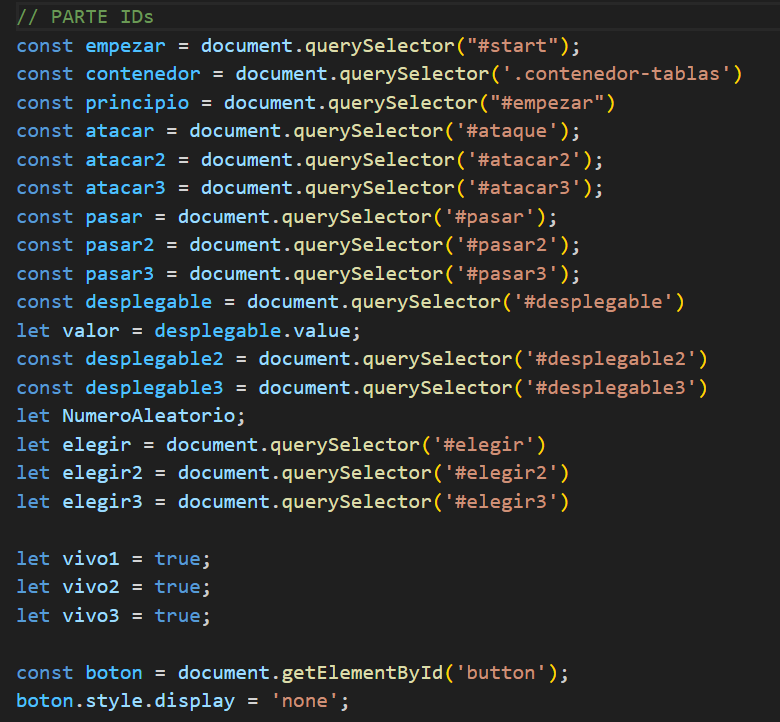
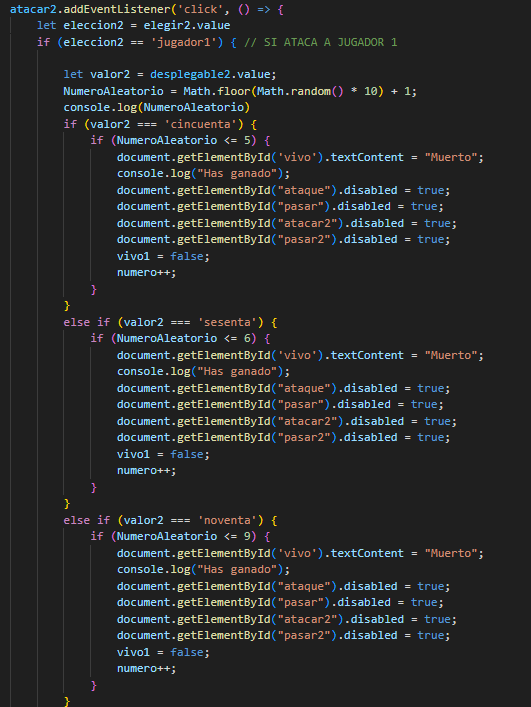
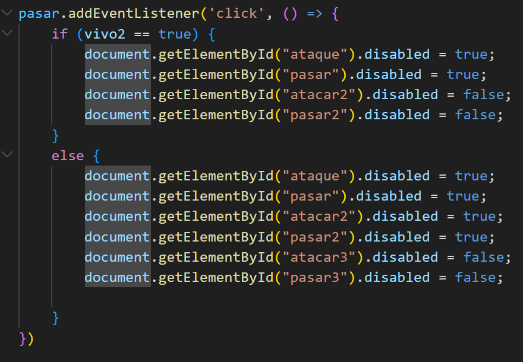

# DUELO DE MAGOS

## Enfréntate con tus amigos a ver quién la tiene más grande (la varita)

### ¿Cómo jugar?

Para jugar, empieza el <b>Jugador 1</b>, elige a quién ataca y con qué posibilidades <i>(60%, 80% o 100%)</i>. Sigue el <b>jugador 2</b>, eligiendo quién ataca y con qué posibilidades <i>(50%, 60% o 90%)</i>, y por último ataca el <b>Jugador 3</b>, eligiendo a quién ataca y con qué posibilidades <i>(40%, 50% o 70%)</i>.

### Normas del juego

1. Una vez un <b>jugador muere</b>, su turno se salta automáticamente y <b>no se le puede atacar</b>.

2. Un jugador no se puede atacar a sí mismo.

3. Una vez acaba la partida, gana el último en pie (es el último con el texto "VIVO"), y para empezar otra partida habrá que darle al botón de abajo.

### Objetivo del juego

Es un juego de estrategia donde la gracia está en que puedes decidir no matar a alguien (reduciendo las posibilidades) para que mate a otro y cuando vuelva a ser tu turno matarlo tú, aunque siempre puede matarte a ti pero morir por el ataque de otro, por eso el cambio de porcentajes.

### Explicación HTML

Creo una sección con el id comenzar, para indicar cuando se borra en el momento de comenzar.

Luego, aparece un div con el contenedor de las tablas que aparecen cuando se da al botón y el valor seleccionado se usa con value y las tablas tienen su ID.

### Explicación JavaScript

Primero tengo todos los IDs como constantes o algunas variables.

Luego, configuro los botones de inicio y de cuando se acaba el juego. 

Los botones del juego funcionan si atacas o pasas, teniendo en cuenta todas las posibilidades :D.

#### Atacar

#### Pasar

### Información Adicional

El juego ha sido Creado por Pedro Servera Fernández para que las personas sepan sobre el maravilloso acertijo de magos y aprendan estrategia.

Este trabajo está dedicado a:
1. Lucía
2. Literatura feminista
3. Maddy Thorson
4. Lena Raine