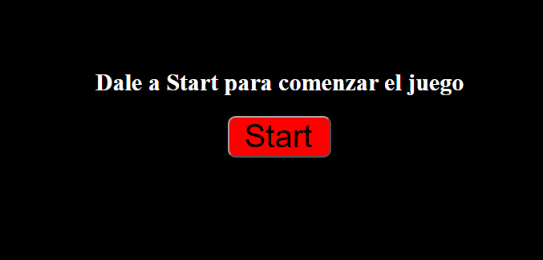
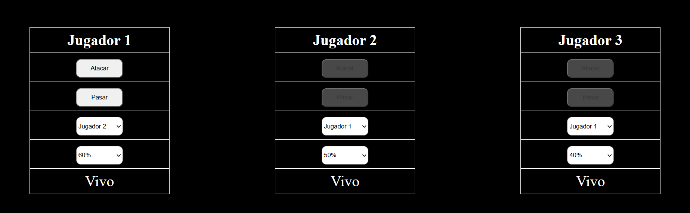

# DUELO DE MAGOS

## Enfréntate con tus amigos a ver quién la tiene más grande (la varita)

### ¿Cómo jugar?

Para jugar, empieza el <b>Jugador 1</b>, elige a quién ataca y con qué posibilidades <i>(60%, 80% o 100%)</i>. Sigue el <b>jugador 2</b>, eligiendo quién ataca y con qué posibilidades <i>(50%, 60% o 90%)</i>, y por último ataca el <b>Jugador 3</b>, eligiendo a quién ataca y con qué posibilidades <i>(40%, 50% o 70%)</i>.

### Normas del juego

1. Una vez un <b>jugador muere</b>, su turno se salta automáticamente y <b>no se le puede atacar</b>.

2. Un jugador no se puede atacar a sí mismo.

3. Una vez acaba la partida, gana el último en pie (es el último con el texto "VIVO"), y para empezar otra partida habrá que darle al botón de abajo.

### Objetivo del juego

Es un juego de estrategia donde la gracia está en que puedes decidir no matar a alguien (reduciendo las posibilidades) para que mate a otro y cuando vuelva a ser tu turno matarlo tú, aunque siempre puede matarte a ti pero morir por el ataque de otro, por eso el cambio de porcentajes.

### Explicación HTML

Creo una sección con el id comenzar, para indicar cuando se borra en el momento de comenzar.



Luego, aparece un div con el contenedor de las tablas que aparecen cuando se da al botón y el valor seleccionado se usa con value y las tablas tienen su ID.



### Explicación JavaScript

Primero tengo todos los IDs como constantes o algunas variables.

```js
const empezar = document.querySelector("#start");
const contenedor = document.querySelector('.contenedor-tablas')
const principio = document.querySelector("#empezar")
const atacar = document.querySelector('#ataque');
const atacar2 = document.querySelector('#atacar2');
const atacar3 = document.querySelector('#atacar3');
const pasar = document.querySelector('#pasar');
const pasar2 = document.querySelector('#pasar2');
const pasar3 = document.querySelector('#pasar3');
const desplegable = document.querySelector('#desplegable')
let valor = desplegable.value;
const desplegable2 = document.querySelector('#desplegable2')
const desplegable3 = document.querySelector('#desplegable3')
let NumeroAleatorio;
let elegir = document.querySelector('#elegir')
let elegir2 = document.querySelector('#elegir2')
let elegir3 = document.querySelector('#elegir3')

let vivo1 = true;
let vivo2 = true;
let vivo3 = true;

const boton = document.getElementById('button');
boton.style.display = 'none';
```

Luego, configuro los botones de inicio y de cuando se acaba el juego. 

Los botones del juego funcionan si atacas o pasas, teniendo en cuenta todas las posibilidades :D.

#### Atacar

```js
atacar.addEventListener('click', () => {
    let eleccion = elegir.value;
    if (eleccion == 'jugador2') { // SI ATACA A JUGADOR2
        let valor = desplegable.value;
        NumeroAleatorio = Math.floor(Math.random() * 10) + 1;
        console.log(NumeroAleatorio)
        if (valor === 'sesenta') {
            if (NumeroAleatorio <= 6) {
                document.getElementById('vivo2').textContent = "Muerto";
                console.log("Has ganado");
                document.getElementById("ataque").disabled = true;
                document.getElementById("pasar").disabled = true;
                document.getElementById("atacar2").disabled = true;
                document.getElementById("pasar2").disabled = true;
                document.getElementById("atacar3").disabled = false;
                document.getElementById("pasar3").disabled = false;
                vivo2 = false;
                numero++;
            }
        }
        else if (valor === 'ochenta') {
            if (NumeroAleatorio <= 8) {
                document.getElementById('vivo2').textContent = "Muerto";
                console.log("Has ganado");
                document.getElementById("ataque").disabled = true;
                document.getElementById("pasar").disabled = true;
                document.getElementById("atacar2").disabled = true;
                document.getElementById("pasar2").disabled = true;
                document.getElementById("atacar3").disabled = false;
                document.getElementById("pasar3").disabled = false;
                vivo2 = false;
                numero++;
            }
        }
        else if (valor === 'cien') {
            if (NumeroAleatorio <= 10) {
                document.getElementById('vivo2').textContent = "Muerto";
                console.log("Has ganado");
                document.getElementById("ataque").disabled = true;
                document.getElementById("pasar").disabled = true;
                document.getElementById("atacar2").disabled = true;
                document.getElementById("pasar2").disabled = true;
                document.getElementById("atacar3").disabled = false;
                document.getElementById("pasar3").disabled = false;
                vivo2 = false;
                numero++;
            }
        }
        if (vivo2 == true) {
            document.getElementById("ataque").disabled = true;
            document.getElementById("pasar").disabled = true;
            document.getElementById("atacar2").disabled = false;
            document.getElementById("pasar2").disabled = false;
        }
        comprobarFin();
    }
    else if (eleccion == 'jugador3') { // SI ATACA A JUGADOR3
        let valor = desplegable.value;
        NumeroAleatorio = Math.floor(Math.random() * 10) + 1;
        console.log(NumeroAleatorio)
        if (valor === 'sesenta') {
            if (NumeroAleatorio <= 6) {
                document.getElementById('vivo3').textContent = "Muerto";
                console.log("Has ganado");
                document.getElementById("ataque").disabled = true;
                document.getElementById("pasar").disabled = true;
                document.getElementById("atacar2").disabled = true;
                document.getElementById("pasar2").disabled = true;
                vivo3 = false;
                numero++;
            }
        }
        else if (valor === 'ochenta') {
            if (NumeroAleatorio <= 8) {
                document.getElementById('vivo3').textContent = "Muerto";
                console.log("Has ganado");
                document.getElementById("ataque").disabled = true;
                document.getElementById("pasar").disabled = true;
                document.getElementById("atacar2").disabled = true;
                document.getElementById("pasar2").disabled = true;
                vivo3 = false;
                numero++;
            }
        }
        else if (valor === 'cien') {
            if (NumeroAleatorio <= 10) {
                document.getElementById('vivo3').textContent = "Muerto";
                console.log("Has ganado");
                document.getElementById("ataque").disabled = true;
                document.getElementById("pasar").disabled = true;
                document.getElementById("atacar2").disabled = true;
                document.getElementById("pasar2").disabled = true;
                vivo3 = false;
                numero++;
            }
        }
        if (vivo2 == true) {
            document.getElementById("ataque").disabled = true;
            document.getElementById("pasar").disabled = true;
            document.getElementById("atacar2").disabled = false;
            document.getElementById("pasar2").disabled = false;
        }
        else if (vivo3 == true) {
            document.getElementById("ataque").disabled = true;
            document.getElementById("pasar").disabled = true;
            document.getElementById("atacar3").disabled = false;
            document.getElementById("pasar3").disabled = false;
        }
        comprobarFin();
    }

}
)
```
#### Pasar

```js
pasar.addEventListener('click', () => {
    if (vivo2 == true) {
        document.getElementById("ataque").disabled = true;
        document.getElementById("pasar").disabled = true;
        document.getElementById("atacar2").disabled = false;
        document.getElementById("pasar2").disabled = false;
    }
    else {
        document.getElementById("ataque").disabled = true;
        document.getElementById("pasar").disabled = true;
        document.getElementById("atacar2").disabled = true;
        document.getElementById("pasar2").disabled = true;
        document.getElementById("atacar3").disabled = false;
        document.getElementById("pasar3").disabled = false;

    }
})
```

### Información Adicional

El juego ha sido Creado por Pedro Servera Fernández para que las personas sepan sobre el maravilloso acertijo de magos y aprendan estrategia.

Este trabajo está dedicado a:
1. Lucía
2. Literatura feminista
3. Maddy Thorson
4. Lena Raine